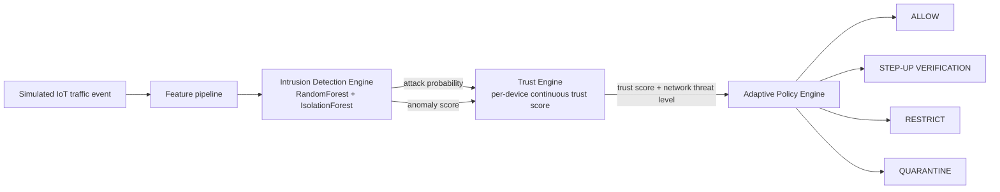

# Adaptive Zero Trust Framework for Intelligent Intrusion Prevention in IoT Networks

A working prototype built for a final-year project. It combines a machine-learning
intrusion detection engine with a continuous, Zero-Trust-style trust-scoring layer
and an adaptive policy engine that turns detection into actual prevention actions
(step-up verification, micro-segmentation, quarantine) — not just alerts.



## Why this architecture

Classic perimeter security assumes anything inside the network is trustworthy.
That assumption breaks down for IoT: devices are heterogeneous, often unpatched,
and easy to compromise (see the Mirai/Bashlite botnets). Zero Trust replaces
"trust once, allow forever" with **continuous verification**: every device is
re-evaluated on an ongoing basis, and access narrows automatically as trust drops.

This prototype implements that loop end-to-end:

| Component | File | Role |
|---|---|---|
| Feature pipeline | `src/preprocessing.py` | Cleans traffic data, encodes categorical fields, simulates an IoT device fleet |
| Intrusion Detection Engine | `src/ids_model.py` | Supervised classifier (attack probability) + unsupervised anomaly detector (catches novel/unknown attacks) |
| Trust Engine | `src/trust_engine.py` | Per-device continuous trust score; asymmetric — falls fast, recovers slowly; tracks a network-wide adaptive threat level |
| Adaptive Policy Engine | `src/policy_engine.py` | Converts trust score → enforcement action; thresholds shift with device criticality and network threat level |
| Simulation | `simulate.py` | Replays real (held-out) attack traffic against a scripted per-device scenario and logs every decision |
| Dashboard | `dashboard/app.py` | Streamlit UI over the simulation log — trust timelines, policy actions, model metrics |

## ⚠️ A note on the dataset (read this before your viva)

This prototype uses **NSL-KDD**, a well-established, publicly available network
intrusion benchmark (~150K labeled connection records). It is **not** a native
IoT packet capture — genuinely IoT-native datasets (N-BaIoT, TON_IoT, CICIoT2023)
are hosted behind UCI/Kaggle and weren't reachable from the build environment
used to scaffold this repo.

To keep the "IoT network" framing honest while still grounding the detection
logic in real, labeled attack traffic, each NSL-KDD record is deterministically
mapped onto a simulated fleet of 12 IoT device profiles (`DEVICE_FLEET` in
`src/preprocessing.py` — smart cameras, a door lock, a gateway hub, etc.), each
with its own criticality weight used by the trust and policy engines.

**If your final submission needs to report results on a real IoT dataset**, swap
`load_raw_data()` in `src/preprocessing.py` for one of:
- [N-BaIoT](https://archive.ics.uci.edu/dataset/442) (UCI ML Repository)
- [TON_IoT](https://research.unsw.edu.au/projects/toniot-datasets) (UNSW Canberra)
- [CICIoT2023](https://www.unb.ca/cic/datasets/iotdataset-2023.html) (UNB)

Nothing else in the pipeline needs to change — `ids_model.py`, `trust_engine.py`,
and `policy_engine.py` are dataset-agnostic; they just need a feature matrix and
a binary `is_attack` label.

## Results (this run)

- **Model**: RandomForest classifier + IsolationForest anomaly detector
- **Test accuracy**: ~76.5%, **ROC-AUC**: ~0.97 — accuracy looks modest because
  NSL-KDD's test split deliberately contains attack types absent from training
  (a generalization stress test, not a bug — see the "why isn't accuracy 100%"
  note in the dashboard)
- **Simulation**: 12 simulated devices, each given a scripted attack campaign
  - Devices were quarantined after seeing an average of **~4 of their own
    malicious events**
  - Only **~8%** of genuinely benign traffic was ever over-restricted (the
    detection-vs-usability tradeoff, worth discussing in your report)
  - Higher-criticality devices (e.g. the gateway hub) recover trust more
    slowly after an attack than low-criticality devices (e.g. a smart TV) —
    a direct, visible demonstration of least-privilege, criticality-aware
    enforcement

Exact numbers regenerate fresh each time you run the pipeline (`outputs/simulation_summary.json`).

## Setup

```bash
git clone <your-repo-url>
cd <repo-name>
pip install -r requirements.txt
```

## Running the pipeline

```bash
python train.py       # trains + evaluates the detection engine, saves models/
python simulate.py    # runs the adaptive zero-trust simulation, saves outputs/
streamlit run dashboard/app.py   # interactive dashboard
```

## Repository structure

```
.
├── data/                   # NSL-KDD train/test CSVs
├── src/
│   ├── preprocessing.py    # data loading, device simulation, feature pipeline
│   ├── ids_model.py        # intrusion detection engine
│   ├── trust_engine.py     # zero-trust continuous trust scoring
│   └── policy_engine.py    # adaptive enforcement policy
├── models/                 # saved trained artifacts (generated)
├── outputs/                # simulation logs + metrics (generated)
├── dashboard/
│   └── app.py               # Streamlit dashboard
├── train.py                 # entry point: train + evaluate
├── simulate.py               # entry point: run the simulation
└── requirements.txt
```

## Limitations & future work

- Swap in a real IoT-native dataset (see note above) for final reported results.
- The device fleet and attack-campaign scenario are scripted/simulated for
  demo clarity; a stronger evaluation would replay multiple overlapping,
  concurrent attacks and randomized campaign timing.
- The trust-update and policy thresholds were hand-tuned; a natural extension
  is learning them (e.g. reinforcement learning) rather than fixing them by hand.
- No real network enforcement is wired up (this simulates policy decisions,
  it doesn't call a firewall/SDN controller) — a natural next step is
  integrating with something like an OpenFlow controller or a Linux
  `iptables`/`nftables` backend to actually enforce the RESTRICT/QUARANTINE
  actions on real traffic.
- The IDS is retrained in batch; a more "adaptive" version would support
  online/incremental learning as new labeled traffic arrives.

## License

MIT — see `LICENSE`.
