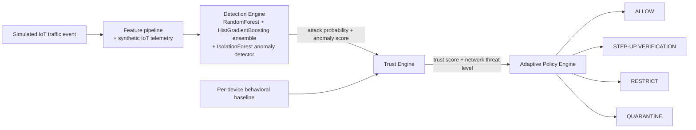

# Adaptive Zero Trust Framework for Intelligent Intrusion Prevention in IoT Networks (v3)

**Live website:** `docs/index.html` (static, deployable on GitHub Pages) &nbsp;|&nbsp; Streamlit dashboard: `dashboard/app.py`

## What's new in v3

Trust is now computed from **four independent factors**, fused with a weighted geometric mean so one failing factor cannot be averaged away:

| Factor | What it measures | Weight |
|---|---|---|
| Identity confidence | Credential age, auth-failure and privilege signals, traffic fingerprint vs. device type, step-up challenge results | 18% |
| Real-time behavior / anomaly | Ensemble attack probability, IsolationForest anomaly score, deviation from the device's own request-rate baseline | 47% |
| Historical reputation | Slow-moving record of past conduct, reduced by earlier incidents | 17% |
| Contextual risk | Time of day, service/protocol risk, network exposure, network-wide threat level | 18% |

- Step-up verification is now a real mechanism: capable devices are challenged, and the result feeds back into identity confidence.
- A professional static website (white background, orange typography) with an interactive fleet explorer and per-factor breakdown. It needs no server, so it never goes to sleep.
- Results (this run): ~91.6% ensemble accuracy, 0.992 ROC-AUC, all 12 devices quarantined during their campaign after ~5.3 of their own malicious events on average, ~1.7% of clean traffic wrongly restricted.


## User accounts, Google login and per-user fleets

`docs/app.html` is a signed-in workspace. Each user gets a **designated network zone** (`10.<zone>.0.0/24`) and stable **slots** for their devices. Scan the network once, add devices to your fleet, and they (plus their trust state and history) are saved to your account, so nothing needs re-scanning after the next login.

- Auth: Google sign-in through Supabase. Data: Postgres tables `profiles`, `devices`, `device_state`, `trust_history`, protected by row-level security so users only ever see their own rows (`supabase/schema.sql`).
- The trust and policy logic runs in the browser (`docs/engine.js`, a port of `src/trust_engine.py`), replaying scored events exported by the Python pipeline (`docs/events.js`).
- **Setup takes about 15 minutes: see `SETUP.md`.** Until Supabase keys are added to `docs/config.js`, the app runs in demo mode with two fake users stored in the browser.

## Deploy the website (GitHub Pages)

1. Push this repo to GitHub.
2. Repo **Settings → Pages → Build and deployment → Deploy from a branch**.
3. Choose branch `master` and folder `/docs`, then Save.
4. Your site appears at `https://<username>.github.io/<repo-name>/` after about a minute.

Regenerate the site data after changing the engine: `python train.py && python simulate.py` (writes `docs/data.js`).

> Honesty notes: step-up challenge outcomes are part of the *simulated environment* (legitimate devices usually pass, attackers usually fail); the trust engine never sees ground-truth labels. Request-rate and payload features are synthetic, as described below.

---
## Earlier version notes (v2)

A final-year project prototype combining an ensemble ML intrusion detection
engine with continuous, Zero-Trust-style trust scoring and an adaptive
policy engine that turns detection into real prevention actions (step-up
verification, micro-segmentation, quarantine).



## What's new in v2

- **Stronger detection**: an ensemble of RandomForest + HistGradientBoosting
  (soft-voted), evaluated individually and as an ensemble — accuracy went
  from ~76.5% (v1, single RandomForest) to **~91.4%** (ROC-AUC 0.99), mostly
  thanks to two added synthetic IoT telemetry features carrying real signal
  (see below).
- **A third, independent trust signal**: alongside the ML classifier and the
  anomaly detector, each device now has its own learned behavioral baseline
  (request-rate EWMA). A device suddenly behaving differently from its *own*
  history is flagged independently of whether the classifier recognizes the
  traffic as a known attack pattern — a lightweight UEBA-style check. The
  baseline is only updated during calm periods, so an ongoing attack can't
  poison a device's definition of "normal."
- **Self-healing Streamlit dashboard**: if the trained model / simulation results are
  ever missing (fresh clone, a cloud deploy where they weren't committed),
  the dashboard trains and simulates automatically on first load (~30s)
  instead of showing an error. Verified end-to-end with Streamlit's
  `AppTest` harness.
- **Live replay mode**: step through a device's simulation event-by-event
  on a timer, instead of only viewing static charts.
- **Explainability**: a model comparison table (RF vs. HistGB vs. ensemble)
  and a feature-importance panel.

## A note on the data

NSL-KDD (a well-established general network-intrusion benchmark) is used
in place of a native IoT capture — genuinely IoT-native datasets (N-BaIoT,
TON_IoT, CICIoT2023) are hosted behind UCI/Kaggle and weren't reachable
from the build environment. Two things bridge the gap:

1. Each record is deterministically mapped onto a simulated fleet of 12 IoT
   device profiles (`DEVICE_FLEET` in `src/preprocessing.py`), each with its
   own criticality weight.
2. Two **synthetic IoT telemetry features** are generated per record:
   `requests_per_min` and `avg_payload_bytes`. These are archetype-conditioned
   baselines perturbed in a direction consistent with how each attack family
   actually manifests in IoT traffic (DoS/Probe → request-rate spikes and
   shrunken payloads; R2L/U2R → smaller, stealthier deviations), plus noise.
   **They are synthetic, not captured packets** — documented here rather
   than passed off as real telemetry. The generation logic is in
   `add_synthetic_iot_telemetry()` in `src/preprocessing.py`.

**For a final submission needing results on a real IoT dataset**, swap
`load_raw_data()` for N-BaIoT / TON_IoT / CICIoT2023 and drop the synthetic
telemetry step — `ids_model.py`, `trust_engine.py`, and `policy_engine.py`
are dataset-agnostic.

## Results (this run)

| Model | Accuracy | F1 | ROC-AUC |
|---|---|---|---|
| RandomForest | 88.0% | 0.884 | 0.987 |
| HistGradientBoosting | 91.8% | 0.922 | 0.990 |
| **Ensemble (used in production)** | 91.4% | 0.919 | **0.992** |

Simulation (12 devices, each given a scripted attack campaign):
- Devices quarantined after an average of **~3.5 of their own malicious events**
- Only **~2.9%** of genuinely benign traffic was ever over-restricted
- The highest-criticality device (gateway hub) ends the simulation at the
  *lowest* recovered trust score of the fleet, while a low-criticality smart
  plug recovers to the highest — a direct demonstration of criticality-aware,
  least-privilege enforcement.

Exact numbers regenerate each run (`outputs/simulation_summary.json`).

## Setup & running

```bash
pip install -r requirements.txt
python train.py             # trains + evaluates the ensemble, saves models/
python simulate.py          # runs the scripted zero-trust simulation, saves outputs/
streamlit run dashboard/app.py   # interactive dashboard (self-heals if models/outputs are missing)
```

`models/` and `outputs/` are committed in this repo so the dashboard works
immediately — you don't need to run `train.py`/`simulate.py` yourself unless
you want to regenerate them (e.g. after changing the model or dataset).

## Repository structure

```
.
├── data/                   # NSL-KDD train/test CSVs
├── src/
│   ├── preprocessing.py    # data loading, device simulation, synthetic telemetry, feature pipeline
│   ├── ids_model.py        # ensemble intrusion detection engine
│   ├── trust_engine.py     # zero-trust continuous trust scoring (3 signals)
│   └── policy_engine.py    # adaptive enforcement policy
├── models/                 # saved trained artifacts (committed)
├── outputs/                # simulation logs + metrics (committed)
├── dashboard/
│   └── app.py               # self-healing Streamlit dashboard
├── train.py
├── simulate.py
└── requirements.txt
```

## Limitations & future work

- Swap in a real IoT-native dataset for final reported results (see above).
- The device fleet and attack-campaign scenario are scripted for demo
  clarity; a stronger evaluation would replay multiple concurrent,
  randomly-timed attacks.
- Trust-update and policy thresholds are hand-tuned; a natural extension is
  learning them (e.g. via reinforcement learning).
- No real network enforcement is wired up — a natural next step is
  integrating with an SDN controller or `iptables`/`nftables` to actually
  enforce RESTRICT/QUARANTINE on real traffic.


## License

MIT — see `LICENSE`.
